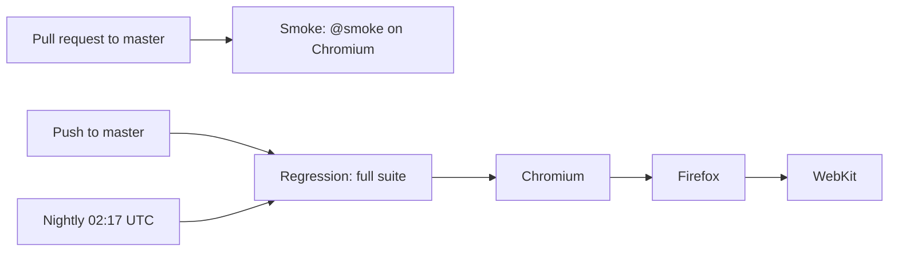

# Automation Exercise - Playwright E2E Tests

[](https://github.com/Mohsintl/automation-exercise-playwright/actions/workflows/smoke.yml)
[](https://github.com/Mohsintl/automation-exercise-playwright/actions/workflows/regression.yml)

An end-to-end test suite for [Automation Exercise](https://automationexercise.com/), a public e-commerce demo site, built with [Playwright](https://playwright.dev/) and TypeScript using the Page Object Model. Contributions of new tests are welcome.

## Stack

- Playwright Test, TypeScript, Node.js
- GitHub Actions: smoke tests on pull requests, a three-browser regression run on `master` and nightly

## Project structure

```
automation-exercise-playwright/
├── .github/workflows/
│   ├── smoke.yml          # @smoke tests on Chromium, every pull request
│   └── regression.yml     # full suite on Chromium, Firefox, WebKit
├── pages/                 # Page Objects
│   ├── BasePage.ts        # navigation, ad blocking, heavy-load retry
│   ├── HomePage.ts
│   ├── LoginPage.ts
│   ├── SignupPage.ts
│   ├── ProductsPage.ts
│   ├── ProductDetailPage.ts
│   ├── CartPage.ts
│   ├── BrandPage.ts
│   └── ContactPage.ts
├── tests/                 # 24 tests in 10 spec files
└── playwright.config.ts
```

## Page Object Model

Each page of the site has a class in `pages/` that owns its locators and actions; tests only call those methods and assert. `BasePage` holds what every page needs:

- **Ad blocking**: requests to ad networks are aborted, since ads cover elements and make clicks flaky.
- **Heavy-load handling**: the site sometimes answers "This website is under heavy load". `BasePage.goto` waits and reloads, up to three times.

## Test coverage

| Spec | Covers |
| :--- | :--- |
| `home.spec.ts` | Home page loads with its main navigation |
| `login.spec.ts` | Login page navigation, error on invalid credentials |
| `registration.spec.ts` | New user signup with a unique generated email |
| `products.spec.ts` | Product listing and search |
| `productDetail.spec.ts` | Product details, quantity, add to cart |
| `cart.spec.ts` | Add to cart, view cart |
| `brand.spec.ts` | Brand listing and filtering |
| `category.spec.ts` | Women, Men, and Kids category filters |
| `contact.spec.ts` | Contact form submission and return home |
| `navigation.spec.ts` | Main sections, Test Cases and API pages, footer subscription |

### Smoke and regression

- **Smoke**: 7 tests tagged `@smoke` covering the critical paths (home, login, product listing and search, add to cart, main navigation). They run on every pull request.
- **Regression**: the whole suite, smoke tests included. Every test is regression, so nothing else is tagged.

## Running locally

Requires Node.js 20 or later.

```bash
npm ci
npx playwright install --with-deps
```

| Command | Runs |
| :--- | :--- |
| `npm test` | Full suite on Chromium, Firefox, and WebKit |
| `npm run test:smoke` | `@smoke` tests on all three browsers |
| `npm run test:chromium` | Full suite on Chromium only |
| `npm run test:headed` | Full suite on Chromium in a visible browser |
| `npm run report` | Opens the last HTML report |

To run one file: `npx playwright test tests/login.spec.ts`.

## CI



- **Smoke** (`smoke.yml`): every pull request to `master`. Installs only Chromium and runs the `@smoke` tests.
- **Regression** (`regression.yml`): every push to `master`, nightly, by hand, and on a pull request that changes the workflow itself. It is a matrix of one job per browser.
  - `max-parallel: 1` runs the browsers one after another, so the public site gets one browser's traffic at a time.
  - `fail-fast: false` lets every browser finish, so one browser failing does not hide the others' results. Any failed browser fails the workflow.
  - The nightly run matters because the site changes without any commit here.
- Both workflows have read-only permissions and cancel a superseded run on the same branch. No secrets are needed: the signup test generates a unique email each run.

### Reliability and evidence

Set in `playwright.config.ts`:

- One worker, no parallel tests, to stay under the demo site's load limits.
- Retries: 2 on CI, 1 locally. `test.only` fails the run on CI.
- On failure: a screenshot and a video. On the first retry: a Playwright trace.
- Reporters: HTML and list, plus GitHub annotations on CI.

### Reading a CI failure

Open the run in the **Actions** tab and download the `smoke-report` or `regression-report-<browser>` artifact. It holds `playwright-report/` (open `index.html`) and `test-results/` with the screenshots, videos, and traces. Open a trace with `npx playwright show-trace <trace.zip>`.

## Contributing

Add tests through the existing Page Objects, and add a Page Object for a new page. Tag a test `@smoke` only if it covers a critical path and runs fast.

## License

ISC

